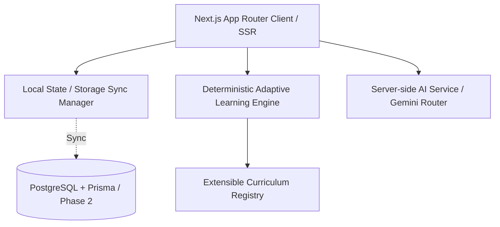

# Architecture Document — StudyQuest AI
*“Learn Your Way. Play Your Way. Grow Every Day.”*

## 1. Overview
StudyQuest AI is an interactive, multi-stage educational web platform serving learners from kindergarten through senior adulthood. The architecture couples a modular Next.js application core with an extensible curriculum repository, a deterministic adaptive learning engine, and a pluggable AI tutor service.

---

## 2. Technology Stack & Rationale

| Component | Selected Technology | Rationale & Alternatives |
| :--- | :--- | :--- |
| **Framework** | **Next.js (App Router, React 19/18, TypeScript)** | High performance, server-side rendering for SEO and accessibility, API route security, and unified full-stack developer ergonomics. |
| **Styling** | **Tailwind CSS + Headless UI / Radix primitives** | Rapid UI development, robust accessible tokens, built-in dark/high-contrast mode, and responsive layout utilities. |
| **Data Validation** | **Zod** | End-to-end schema validation for API inputs, curriculum manifests, user preferences, and AI tutor structured responses. |
| **Persistence (Phase 1)** | **Browser LocalStorage + State Hydration Manager** | Zero-friction local setup, instant responsiveness, offline capability, and portable state export/import. |
| **Persistence (Phase 2+)** | **PostgreSQL + Prisma ORM** | ACID transactions, strict relational typing for students, parents, classrooms, progress records, and audit logs. |
| **AI Integration** | **Gemini API (Server-side proxy)** | Cost-effective, high-context reasoning for personalized pedagogical tutoring, hints, and curriculum grounding. Keeps keys off clients. |
| **Speech & Audio** | **Web Speech API + Pluggable TTS Provider** | Native browser synthesis and recognition for Phase 1 with zero latency; abstraction interface allows plug-in of Cloud TTS / Whisper in future phases. |
| **Testing** | **Vitest + Playwright** | Fast unit and integration testing with Vitest; cross-browser and mobile viewport verification with Playwright. |
| **Billing (Phase 6)** | **Stripe (Test Mode)** | Safe, compliant subscription lifecycle management for the Plus tier (CAD $9.99/mo). |

---

## 3. Modular Architecture Layers

### A. Presentation Layer (`src/components`, `src/app`)
- **Core Layouts**: Responsive navigation, mobile bottom navigation, keyboard skip links, accessible announcements.
- **Learning Worlds**: Dynamic styling and UI density adapted to 5 user tiers:
  1. *Early Explorer* (Kindergarten): Big buttons, phonics, friendly characters, playful colors.
  2. *Junior Adventurer* (Elementary): Quests, badges, mystery missions, hands-on puzzles.
  3. *Scholar* (High School): Clean subject cards, exam timers, formula helpers.
  4. *Academy* (College / University): Deep-dive academic modules, research notes, case simulations.
  5. *Lifelong Learner* (Adult & Senior): High-legibility typography, adjustable contrast, distraction-free reading, practical topics.
- **Learning Activities**: Interactive modules for Multiple Choice, Fill-in-the-Blank, Matching, Flashcards, Science Simulators, and Story Adventures.

### B. Curriculum Layer (`src/curriculum`)
- **Extensible Schema**: Decoupled from hardcoded UI. Content is organized hierarchically:
  `Subject -> Course -> Unit -> Lesson -> Skill -> InteractiveActivities & AssessmentQuestions`.
- Add new subjects (e.g. Quantum Computing, Conversational French) by authoring declarative JSON/TS manifests conforming to `CurriculumSubject` Zod schemas without rebuilding application logic.

### C. Adaptive Learning & Scoring Engine (`src/lib/engine`)
- **Deterministic Math**: Evaluates answers, hint penalties, streak multipliers, and mastery percentages.
  - Initial mastery $M_0 = 0$
  - Successful attempt: $M_{new} = \min(100, M + \Delta)$, where $\Delta = 20 \times (1 - 0.25 \times \text{hints\_used})$
  - Unsuccessful attempt: $M_{new} = \max(0, M - 10)$ with recommended targeted review
- **Spaced Repetition Schedule**: Leitner box algorithm calculating review intervals: $1 \text{ day} \to 3 \text{ days} \to 7 \text{ days} \to 14 \text{ days} \to 30 \text{ days}$.

### D. AI Service Layer (`src/lib/ai`)
- Server-side endpoint routing requests to Google Gemini with rigorous pedagogical system instructions:
  - Socratic guidance: Never solve homework outright; scaffold student discovery with questions and hints.
  - Grounding: Restrict answers to reviewed lesson text or uploaded references.
  - Citation transparency: Mark unverified concepts and cite reference paragraphs.

### E. Speech & Accessibility Layer (`src/lib/speech`, `src/lib/a11y`)
- Unified audio service handling Text-To-Speech (TTS) and Speech-To-Text (STT).
- Graceful degradation: If browser mic or synthesis is disabled or unsupported, UI displays text transcripts and audio controls cleanly.
- Full WCAG 2.2 AA support: Screen-reader live regions, high-contrast toggle, font-size adjuster, reduced-motion compliance.
