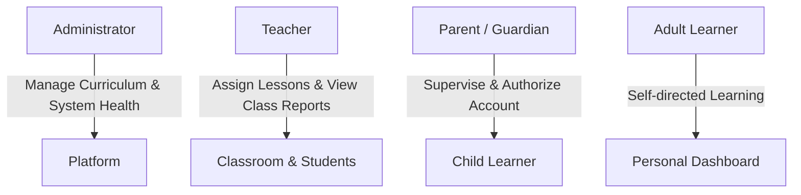

# Privacy, Safety & Child Protection Architecture — StudyQuest AI

## 1. Compliance Mandates & Regulatory Overview
StudyQuest AI is built to educate learners of all ages, with special legal safeguards for minors. The platform targets compliance with:
- **Canada**: *Personal Information Protection and Electronic Documents Act* (PIPEDA) & provincial privacy statutes (e.g. BC PIPA, Alberta PIPA, Quebec Law 25).
- **United States**: *Children’s Online Privacy Protection Act* (COPPA) & state student privacy acts (FERPA/SOPPA).
- **European Union / UK**: *General Data Protection Regulation* (GDPR) Article 8 (GDPR-K) and the UK Age Appropriate Design Code.

> [!IMPORTANT]
> Formal regulatory certifications require third-party legal validation prior to commercial public launch. The safeguards documented here represent foundational technical and architectural controls.

---

## 2. Child Protection Guardrails

### A. Under-13 (COPPA / PIPEDA) Safeguards
1. **Verifiable Parental Consent (VPC)**:
   - For learners identifying as under the age of digital consent (under 13 in the US/Canada, up to 16 in certain EU jurisdictions), accounts must be created and authorized by a verified parent or guardian.
2. **Zero Public Exposure**:
   - No unrestricted public chat rooms.
   - No direct messaging between minor users and adult or unverified strangers.
   - No public user profiles, search engine indexing, or public leaderboards for minors.
3. **Zero Behavioral Tracking & No Targeted Advertisements**:
   - No behavioral profiling, commercial tracking pixels, or targeted advertising cookies.
   - Content and recommendations are driven strictly by the student's on-platform learning history.

### B. AI Safety & Content Filters
- **Strict Socratic System Prompts**:
  - The AI tutor rejects prompts requesting inappropriate, violent, sexual, or non-educational content.
  - The tutor rejects attempts to complete unearned homework ("Please write my essay").
- **Toxicity & Hallucination Guardrails**:
  - Outgoing and incoming AI text passes through validation checks.
  - Sourced curriculum documents ground the AI's factual statements.

---

## 3. Role-Based Access Control (RBAC)

- **Learner (Child)**: Read-only profile visibility, access to age-appropriate learning worlds, tutor chat bounded to current lesson.
- **Parent**: Direct control over linked child accounts, ability to inspect chat logs, adjust daily time limits, and request immediate data purge.
- **Teacher**: Manage class cohorts, assign curriculum units, inspect aggregate mastery metrics without accessing private home chat.
- **Admin**: System configuration, curriculum publishing, security monitoring.

---

## 4. Data Minimization, Export & Deletion
- **Principle of Data Minimization**: We only collect the minimum required data (age tier, learning goals, study time, learning progress). Real names and exact dates of birth are not required for learning.
- **Data Portability**: Users and parents can export their complete learning history as a standardized JSON package at any time.
- **Right to Be Forgotten**: One-click account and data deletion permanently purges all progress records, chat logs, and preferences from local storage and remote databases.
