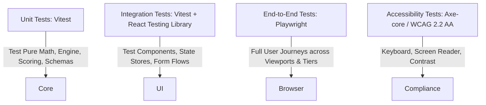

# Quality Assurance & Test Plan — StudyQuest AI

## 1. Testing Philosophy
Every component, utility, and state transition in StudyQuest AI must be backed by verifiable, automated tests. In accordance with `AGENTS.md`, no feature is considered complete until all tests run and pass without warnings or errors.

---

## 2. Testing Levels & Tooling

### A. Unit Tests (Vitest)
- **Deterministic Adaptive Engine**:
  - Scoring calculation with 0, 1, and 2 hints used.
  - Mastery progression bounds ($0 \le \text{Mastery} \le 100$).
  - Spaced repetition interval updates.
  - Streak preservation and midnight rollover logic.
- **Curriculum Validation**:
  - Schema conformity for all 7 demonstration modules.
  - Correct answer key uniqueness and explanation presence.
- **Storage Layer**:
  - Serialization, migration, and error resilience when storage is disabled.

### B. Integration Tests
- **Onboarding Wizard**:
  - Validates completion of all 6 steps.
  - Correct personalization routing based on learning preference (Visual, Audio, Reading/Writing, Hands-on, Mixed).
- **Interactive Quiz Runner**:
  - Multiple choice selection, hint button triggering, explanation display, and XP award.

### C. End-to-End Tests (Playwright)
- Cross-browser coverage (Chromium, Firefox, WebKit).
- Responsive viewports:
  - Mobile: 375x667 (iPhone SE)
  - Tablet: 768x1024 (iPad)
  - Desktop: 1280x800
- Multi-age scenario test matrix.

---

## 3. Multi-Age Test Matrix

| Persona | Age Group | Viewport | Test Focus | Expected Outcome |
| :--- | :--- | :--- | :--- | :--- |
| **Leo (Child)** | Kindergarten | Tablet / Touch | Big button navigation, audio counting, visual animal cards. | Phonics/counting renders with clear visuals, friendly celebratory banner, no complex text. |
| **Maya (Grade 4)** | Elementary | Mobile | Fraction pizza activity, hint usage, retry on incorrect answer. | Hint reduces question XP correctly; explanation clarifies numerator vs denominator. |
| **Sam (Teen)** | High School | Laptop | Linear algebra slider, formula breakdown, timed practice. | Slope-intercept equation updates dynamically with graph coordinates. |
| **Jordan (College)** | University | Desktop | Machine learning gradient descent, loss curve analysis. | Clear academic prose, KaTeX mathematical formulas, deep diagnostic feedback. |
| **Eleanor (Senior)** | Adult / Senior | Desktop / Large Font | High contrast mode, 125% text scale, cybersecurity quiz. | Accessible typography, zero distracting animations, clear phishing indicators. |

---

## 4. Accessibility & Safety Verification
- **WCAG 2.2 AA Checks**:
  - Focus trapping and visible tab rings on all modals.
  - Contrast ratios $\ge 4.5:1$ for normal text, $\ge 3:1$ for large text.
  - Full keyboard navigability (Tab, Enter, Space, Arrow keys, Escape).
  - ARIA live announcements for quiz results and score updates.
- **Offline / Failure State Testing**:
  - Handles AI service unavailability gracefully with fallbacks to static verified curriculum.
